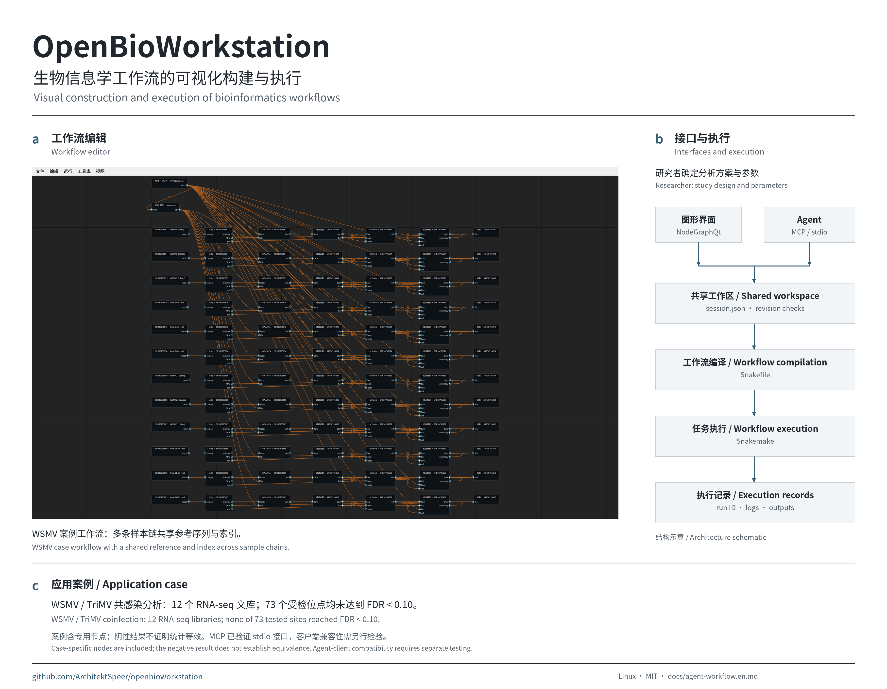
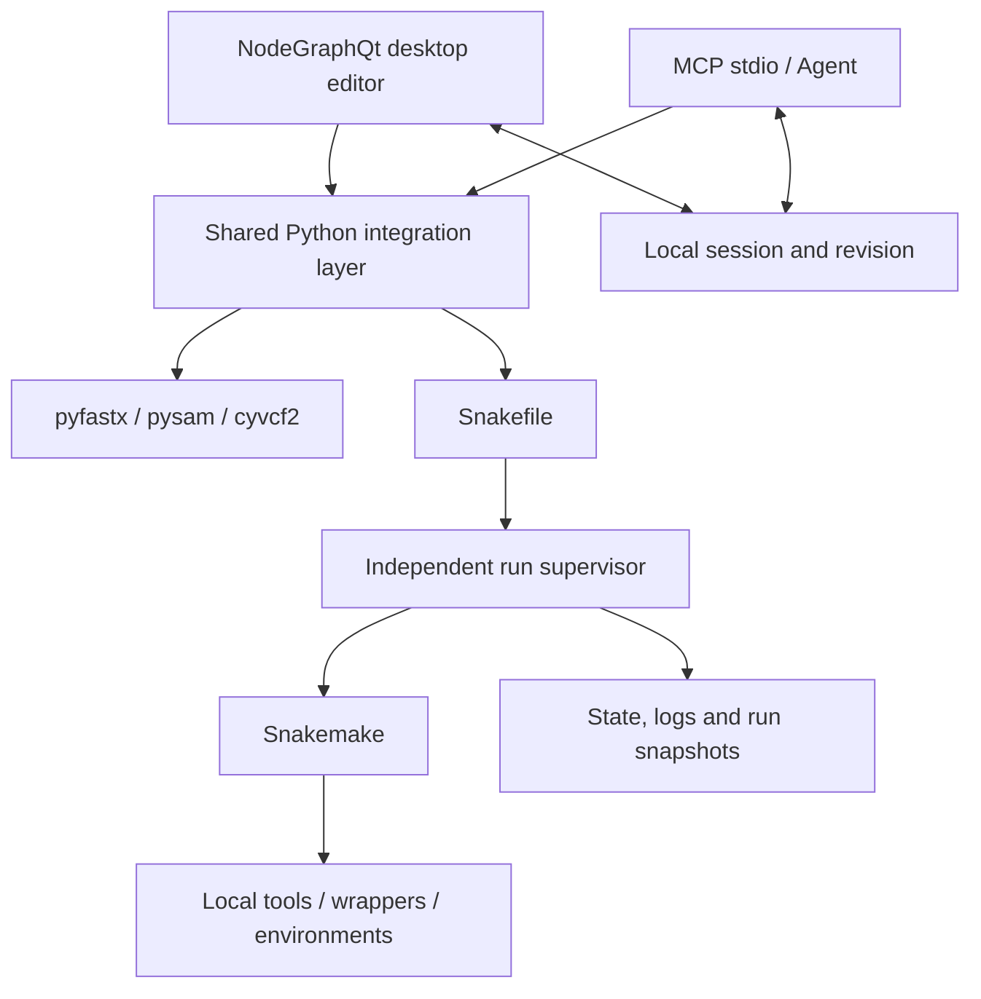
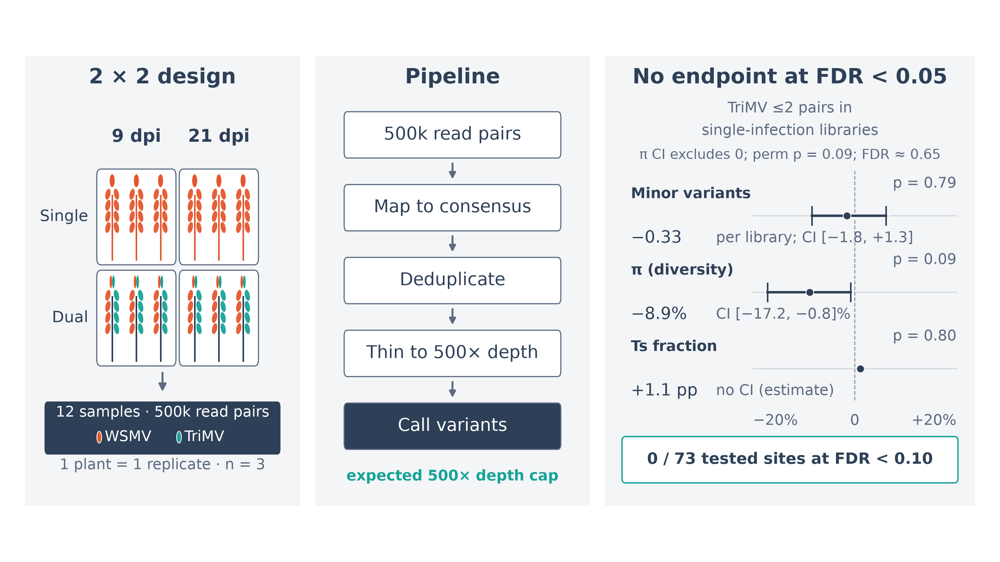

# OpenBioWorkstation

[简体中文](README.md) | **English**

**A visual workflow construction and execution platform for local bioinformatics analysis**

OpenBioWorkstation is a Linux desktop application integrating a NodeGraphQt editor, Snakemake workflow execution and a Model Context Protocol (MCP) interface. A shared workspace associates graph structure, tool definitions, execution state and run records, supporting interactive workflow construction and agent-assisted operation.

The project reuses established components for graph interaction, scheduling and biological file parsing. Its integration layer adapts tool metadata, compiles workflows and coordinates execution state. The aim is to support inspectability and traceability; reproducing results across environments still requires complete records of inputs, tool versions, parameters and dependencies.

- **Construction:** represent analysis steps and data dependencies as nodes and connections, with file-format compatibility checks.
- **Execution:** compile graphs into Snakemake workflows; run the full graph, run up to a target, force a single step or skip cached outputs.
- **Inspection:** display node states, inspect files, preview bounded records and review run history.
- **Programmatic access:** agents construct and execute workflows through MCP, using the same workspace as the graphical interface.



[Bilingual poster](promo/poster.png) · [A3 PDF](promo/poster.pdf) · [Communication materials](promo/README.md)

## Installation and quick start

Requirements: Linux, Python 3.11+ and a desktop environment. These instructions use `uv`. Bioinformatics executables and Conda/Mamba are installed separately as required; pure shell workflows do not require Conda.

```bash
git clone https://github.com/ArchitektSpeer/openbioworkstation.git
cd openbioworkstation
uv venv .venv
uv pip install --python .venv/bin/python -r requirements.txt
./run-demo.sh
```

The offline demo inspects synthetic FASTQ/FASTA files and generates HTML/JSON reports. It does not perform read-quality filtering, alignment or variant analysis. Execution requires neither network access nor Conda, although initial Python dependency installation requires an available package source. See the [demo guide](examples/README.en.md).

Open a standard workspace:

```bash
.venv/bin/python -m ui.workstation_window --workspace ~/biows/projects/demo
```

## Agent-assisted bioinformatics analysis

The researcher defines the question, study design, parameters and interpretation. The agent searches tools, constructs graphs, starts runs and collects execution evidence through MCP. Here, an experiment means computational analysis; the software does not control wet-lab equipment.

- [English tutorial: setup, tool calls and real-data analysis](docs/agent-workflow.en.md)
- [中文教程](docs/agent-workflow.zh-CN.md)
- [Bilingual communication copy and assets](promo/README.md)

Start with the synthetic FASTQ-to-SeqKit exercise before using real data. The tutorial follows the current MCP interface; compatibility with each agent client requires separate verification.

## Architecture and implementation



Graph checks reject incompatible formats, duplicate connections to single-input ports and directed cycles. File inspection delegates to established parsers; a bounded preview cannot establish whole-file integrity. Graphs are stored as JSON. The UI and MCP interface use optimistic revision checks to avoid silent overwrites. Each run retains its Snakefile, session, command and state. An independent supervisor can continue recording execution after the UI or MCP server exits.

### MCP connection

```bash
.venv/bin/python -m mcp_server.bio_mcp --workspace ~/biows/projects/demo
```

Generic client configuration; replace `/path/to` with actual absolute paths. Client-specific configuration conventions may differ.

```json
{
  "mcpServers": {
    "openbioworkstation": {
      "command": "/path/to/openbioworkstation/.venv/bin/python",
      "args": ["-m", "mcp_server.bio_mcp", "--workspace", "/path/to/workspace"],
      "env": {"PYTHONPATH": "/path/to/openbioworkstation"}
    }
  }
}
```

Nine high-level tools cover discovery, node creation, connections, asynchronous execution, status queries, output inspection and Bioconda wrapping jobs. Generated definitions are unreviewed by default and require review for default execution. The stdio interface has been tested; integration with end-user agent clients such as Claude Desktop has not been established by those tests.

### Tools and configuration

Five built-in wrapper definitions cover fastp, BWA index/mem and SAMtools sort/index. Base local nodes cover fastp, BWA index/mem, SAMtools view/sort/index, BCFtools stats and SeqKit stats. Current code additionally defines SAMtools filtering/deduplication and pysam-based viral-site statistics. Nodes requiring external executables appear only when the corresponding packages and binaries are available; viral-site statistics uses Python/pysam.

```bash
conda create -y --solver libmamba --override-channels \
  -c conda-forge -c bioconda --strict-channel-priority \
  -p ~/.cache/biows/common-tools fastp bwa samtools bcftools seqkit
```

`BIOWS_COMMON_ENV` selects another installed environment. Download upstream metadata with `python -m glue.fetch_catalog --all`. Existing records describe a snapshot of 15,447 entries from snakemake-wrappers, nf-core/modules and Bioconda. An indexed entry is not necessarily an executable or validated tool.

The default configuration is `~/.config/biows/config.yaml`; `--config FILE` selects another file:

```yaml
workspace: ~/biows/projects/demo
cores: 4
deploy: conda
conda_bin: /opt/miniconda3/bin/conda
allow_unreviewed: false
llm_base_url: https://api.deepseek.com
llm_api_key: ""
llm_model: deepseek-flash
allowed_input_roots:
  - ~/biows/input
```

Inputs must be inside the workspace or an allowed input root. MCP output inspection is restricted to the workspace. See the [design document, in Chinese](DESIGN.md) for upstream and environment settings.

### Batch wrapping from a predefined manifest

`tool_packs/top50.yaml` provides `biows` definitions for 50 tools; 11 use directory outputs marked with `directory: true`.

```bash
python -m glue.wrap_batch --manifest tool_packs/top50.yaml \
  --conda /opt/miniconda3/bin/conda
```

The command creates isolated Conda environments using conda-forge and bioconda, writes `auto:` definitions and checks executable availability. Definitions default to `reviewed=false`; review them before selecting the canvas action that marks them reviewed. Subcommands can share an environment through `binary`; additional dependencies can be specified through `dependencies`.

Optional synthetic smoke tests:

```bash
python validation/wrap_smoke.py --review-passed
```

The script executes definitions with synthetic FASTA/FASTQ/BED/VCF/GTF/BAM inputs and checks exit codes and output files. `--review-passed` marks only passing entries as reviewed. Existing records report 50 wrapped tools, of which 46 passed synthetic smoke tests and were marked reviewed; GATK, MACS3, SPAdes and Flye received availability checks only. These records do not establish correctness on arbitrary real datasets.

Recorded end-to-end checks include auto-wrapped SeqKit, fastp via a `smk:` wrapper and Conda, FastQC directory output, BCFtools query on a real VCF and SAMtools flagstat on a real BAM. Runtime configuration isolates Conda default channels to avoid the recorded Conda 26 terms-of-service prompt.

### On-demand wrapping

Use the tool-library context menu for a `conda:` or `auto:` entry, or run:

```bash
python -m glue.wrap_service --tool conda:fastp --wait
```

An MCP client can call `wrap_tool("conda:fastp")` and poll `get_wrap_job(job_id)`. The process creates an environment, retrieves CLI help, requests an LLM-generated definition, validates it and attempts execution on synthetic inputs. Configure `llm_base_url`, `llm_model` and `llm_api_key`, or the corresponding `BIOWS_LLM_*` variables.

- `wrapped`: generation and trial execution succeeded; the definition remains unreviewed.
- `needs_review`: a definition was generated, but trial execution failed and requires inspection.
- `needs_definition`: no LLM is configured or generation failed; help text is returned.

Without an LLM, environment creation and help extraction remain available for researcher- or agent-authored definitions.

### Prewarming commonly used tools

```bash
python validation/prewarm_tools.py --conda /opt/miniconda3/bin/conda
```

The script reads 191 package names from `tool_packs/prewarm.txt`, skips already wrapped or unavailable entries, and stops when free disk space falls below 25 GB. Results are written locally to `validation/prewarm-result.json`.

## Application case: WSMV coinfection analysis

The case used 12 RNA-seq libraries to demonstrate tool connection, execution and downstream analysis. Its existing summary reports that none of 73 tested sites reached FDR < 0.10 in the analysis of TriMV coinfection and within-host WSMV diversity. This indicates no statistically significant association under the sampled conditions and specified analysis; it does not establish absence of an effect or statistical equivalence.

The case illustrates an application, rather than general biological validation. Some steps used case-specific nodes.



This public repository includes software, documentation, presentation images and authorized [research showcase attachments](promo/research/README.md): the case manuscript, research introduction, software walkthrough and a separate exploratory wheat chloroplast RNA-editing report. These existing artifacts are not presented as published or peer-reviewed findings. Complete raw data, analysis scripts, reference files and run workspaces are not included, so the repository is not a complete research reproducibility archive. Case-specific nodes shown in historical screenshots should not be assumed to be default validated tools; current available nodes are described above.

## Current limitations

- Historical metadata records contain 15,447 entries: 418 snakemake-wrappers, 2,125 nf-core entries and 12,888 Bioconda entries. Execution is limited to built-in definitions, local nodes whose dependencies are satisfied, and locally wrapped tools. The Top-50 manifest provides 50 definitions, including 11 directory outputs; 46 passed synthetic smoke tests. Only 86 nf-core modules were convertible to shell commands in the recorded snapshot.
- The fastp `smk:` wrapper/Conda path was tested. All 418 upstream wrappers have not been individually validated; initial downloads require network access.
- Stdio tests do not establish compatibility with a particular end-user agent client.
- Linux, single machine; no multi-user service, remote collaboration or cluster configuration interface. Multiple samples require separate node chains; wildcard expansion is not implemented.
- nf-core conversion is conservative. CWL support is restricted to static File/File[] ports and output names and requires a separate cwltool installation.
- Format labels do not establish biological validity, and bounded previews are not full-file validation. No validated performance or speed claim is made.
- Generated definitions remain unreviewed by default. Synthetic success does not establish correct parameters or real-data analysis; inspect shell commands and ports before use.

## Development, verification and presentation assets

The [design document, in Chinese](DESIGN.md) records implementation details and verification scope. Developer checks:

```bash
uv pip install --python .venv/bin/python -r requirements-dev.txt
.venv/bin/python -m pytest -q
.venv/bin/ruff check glue ui mcp_server examples tests
```

Presentation images use actual offscreen UI captures and case-result figures, rather than AI-generated interfaces. Rebuild with Pillow and Noto Sans CJK SC:

```bash
python promo/scripts/make_grid.py
python promo/scripts/make_poster.py
```

See [asset provenance](promo/README.md) and the [visual review record](promo/review_log.md). Internal design and historical review documents are currently Chinese; the public overview, agent tutorial and communication copy have English counterparts.

## License

[MIT](LICENSE), copyright OpenBioWorkstation contributors. Dependencies and invoked tools retain their respective licenses.
