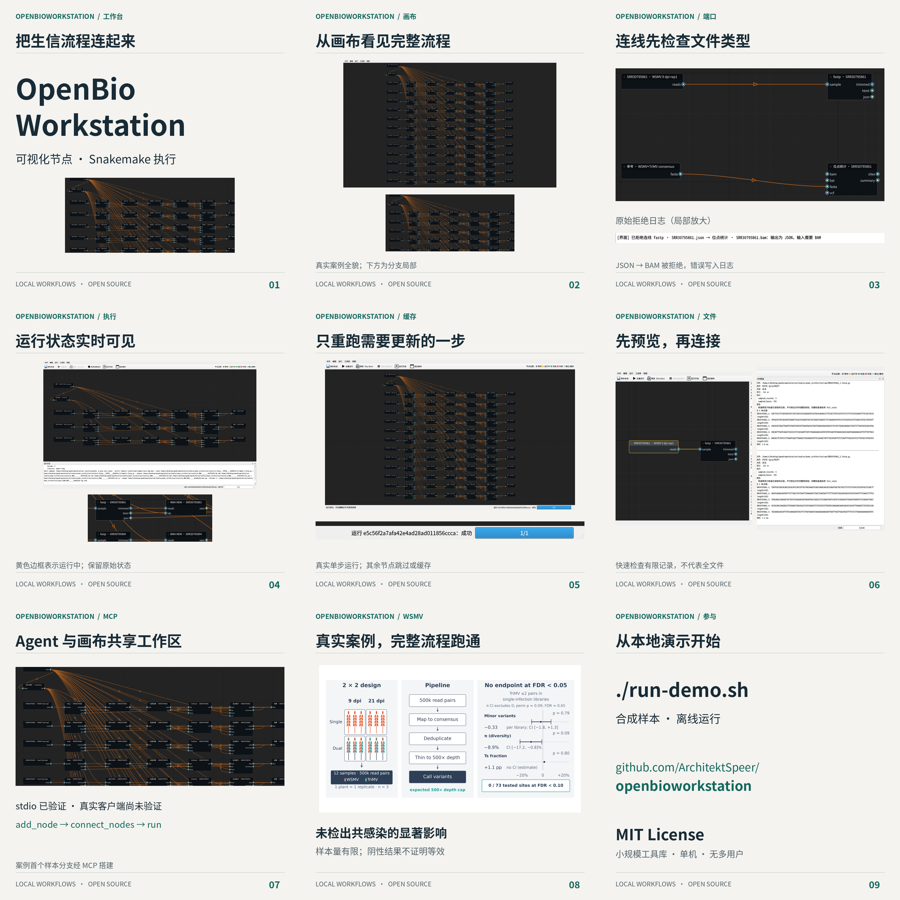
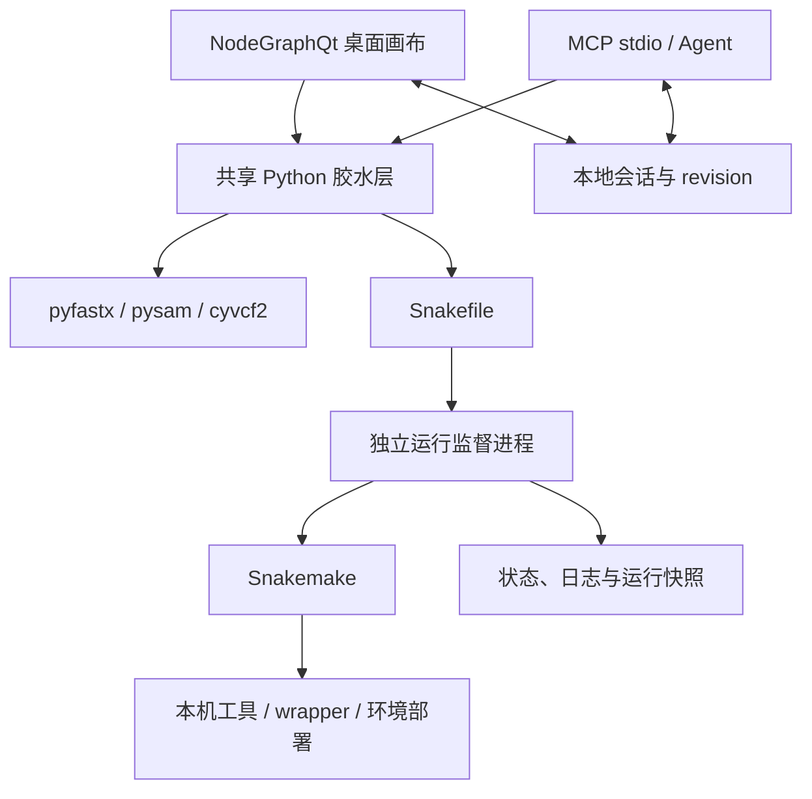
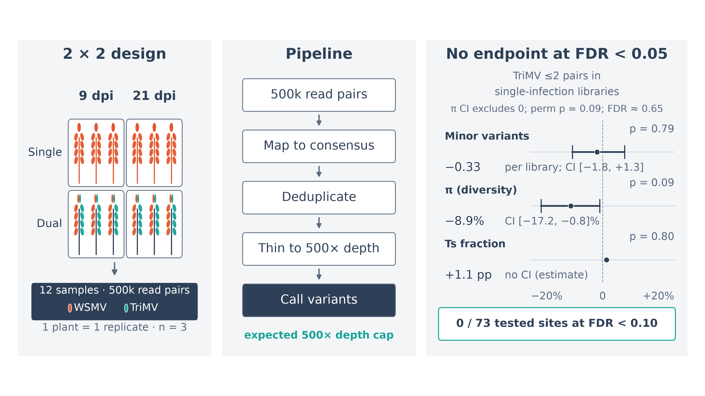

# OpenBioWorkstation

**把生信流程连起来，让每一步可见。**

Linux 本地生信节点工作台：NodeGraphQt 画布、Snakemake 执行，以及共享工作区的 MCP 服务。复用成熟开源组件，不重复造轮子。

- 节点画布与文件格式端口检查。
- 编译为 Snakemake：全量、运行至此、单步重跑与缓存跳过。
- 实时节点着色、文件校验与预览、运行历史。
- Agent 通过 MCP 搭图与运行，UI 与 Agent 同步共享工作区。



[高清海报](promo/poster.png) · [A3 PDF](promo/poster.pdf) · [宣传文案及声明依据](promo/copy.md)

## 安装与快速开始

需要 Linux、Python 3.11+ 和可用的桌面环境。`uv` 用于下面的安装示例。实际生信工具及 Conda/Mamba 按运行模式另行安装；纯 shell 流程不要求 Conda。

```bash
git clone https://github.com/ArchitektSpeer/openbioworkstation.git
cd openbioworkstation
uv venv .venv
uv pip install --python .venv/bin/python -r requirements.txt
./run-demo.sh
```

离线演示使用合成 FASTQ / FASTA，执行文件检查和 HTML / JSON 报告生成；演示流程本身不需网络或 Conda，但首次安装 Python 依赖需要可用的软件源。它不执行测序质控、比对或变异分析。操作详见 [演示说明](examples/README.md)。

打开普通工作区：

```bash
.venv/bin/python -m ui.workstation_window --workspace ~/biows/projects/demo
```

## 核心特性与架构



端口检查拒绝不兼容格式、重复输入与环。文件检查分发给成熟解析库；快速预览只读取有限记录，不能证明全文件完整。图结构保存为 JSON，UI 与 MCP 使用 revision 乐观锁避免静默覆盖。每次运行保留 Snakefile、会话、命令与状态；独立监督进程可在 UI / MCP 退出后继续记录运行。

### MCP 接入

```bash
.venv/bin/python -m mcp_server.bio_mcp --workspace ~/biows/projects/demo
```

客户端配置模板（将 `/path/to` 换成实际绝对路径）：

```json
{
  "mcpServers": {
    "openbioworkstation": {
      "command": "/path/to/openbioworkstation/.venv/bin/python",
      "args": ["-m", "mcp_server.bio_mcp", "--workspace", "/path/to/workspace"],
      "env": {"PYTHONPATH": "/path/to/openbioworkstation"}
    }
  }
}
```

提供检索、加节点、连线、异步运行、状态查询、输出预览及 Bioconda 自动封装共 7 个高层工具。自动封装默认未审核，须审核后才能默认执行。已通过 stdio 客户端验证，尚未在 Claude Desktop 等真实客户端中验证。

### 工具与配置

开箱可运行的是 5 个内置 wrapper 定义（fastp、BWA index/mem、SAMtools sort/index）与 8 个本机工具节点（fastp、BWA index/mem、SAMtools view/sort/index、BCFtools stats、SeqKit stats）。此外可用 `python -m glue.fetch_catalog --all` 下载上游元数据，索引 snakemake-wrappers、nf-core/modules 与 Bioconda 共 15,447 条；其中可直接执行的数量见“当前限制”。本机节点仅在相应包和可执行文件存在时出现。可用以下命令建立本机环境：

```bash
conda create -y --solver libmamba --override-channels \
  -c conda-forge -c bioconda --strict-channel-priority \
  -p ~/.cache/biows/common-tools fastp bwa samtools bcftools seqkit
```

`BIOWS_COMMON_ENV` 可指定另一套已安装环境。默认配置在 `~/.config/biows/config.yaml`，支持 `--config FILE`：

```yaml
workspace: ~/biows/projects/demo
cores: 4
deploy: conda
conda_bin: /opt/miniconda3/bin/conda
allow_unreviewed: false
allowed_input_roots:
  - ~/biows/input
```

输入必须位于工作区或许可根目录内，MCP 输出预览限于工作区。上游目录与环境选项见 [设计文档](DESIGN.md)。

### 批量封装 Top-50 工具

`tool_packs/top50.yaml` 收录 50 个常用工具：37 个已提供 `biows` 定义，13 个需要目录/数据库类端口，暂列 pending。执行：

```bash
python -m glue.wrap_batch --manifest tool_packs/top50.yaml \
  --conda /opt/miniconda3/bin/conda
```

命令会为每个包创建独立 Conda 环境（固定 conda-forge + bioconda，不使用 defaults 渠道）、写入 `auto:` 定义并做一次存活检查。定义默认 `reviewed=false`，需在画布右键“标记为已审核”后才会被默认运行。多子命令工具（如 `samtools-faidx`）通过 `binary` 字段复用同一环境。

合成数据冒烟（可选）：

```bash
python validation/wrap_smoke.py --review-passed
```

脚本用合成的 FASTA/FASTQ/BED/VCF/GTF/BAM 逐个执行定义中的 shell，检查退出码与输出文件；`--review-passed` 会只把通过的条目标记为已审核。

首批结果：37 个工具已封装，**35/35 合成数据冒烟通过并审核**（`hmmsearch`、`barrnap` 仅做存活检查）；`seqkit` 已通过「画布 → Snakemake」端到端运行验证（2/2 步）。运行期会自动隔离 conda 默认渠道，避免 conda 26 的 ToS 阻塞。

## 真实案例：WSMV 共感染分析

WSMV 案例用 12 个 RNA-seq 文库跑通了从工具接线、真实运行到结果分析的完整流程。未检出 TriMV 共感染对 WSMV 宿主内多样性的显著影响：73 个受检位点中无位点达到 FDR < 0.10。样本量有限，阴性结果不证明等效。此案例证明流程可完成，不代表重大生物学发现或所有分析均由内置节点完成。



公开仓库仅发布软件、文档与宣传成品图。案例原始数据、分析脚本、工作区、报告和论文均未发布；截图中的案例专用节点不属于内置工具库。

## 当前限制

- 可检索规模已实测：下载上游元数据后索引 15,447 条（snakemake-wrappers 418、nf-core 2,125、Bioconda 12,888）。可直接执行的限于 5 个内置 wrapper、8 个条件可用的本机节点，以及本机按需封装的 Bioconda 工具；Top-50 清单首批 37 个工具已提供定义（35 个通过合成数据冒烟并审核）。nf-core 仅 86 个模块可自动生成 shell；Bioconda 长尾需按需封装并审核。
- `smk:` wrapper + Conda 环境链路从未真实跑通，不能把本机工具运行当作该链路的验证。首次获取 wrapper / 环境需要网络与可用 Conda。
- MCP 已验证 stdio 接口，尚未在真实 Agent 客户端（如 Claude Desktop）中实测。
- Linux 单机，无多用户、远程协作或集群配置界面；无多样本通配符展开，使用多条节点链。
- nf-core 转换保守，不能静态转换的模块不可运行；CWL 仅支持静态 File/File[] 端口与静态输出名，需另装 cwltool。
- 格式标签不等于生物学语义校验；快速预览不等于全文件验证。没有已验证的性能或速度承诺。

## 开发与物料重建

设计、完成度与验证边界以 [DESIGN.md](DESIGN.md) 为准。测试：

```bash
uv pip install --python .venv/bin/python -r requirements-dev.txt
.venv/bin/python -m pytest -q
.venv/bin/ruff check glue ui mcp_server examples tests
```

宣传图使用真实离屏 UI 截图及案例结果图，无 AI 生成界面。安装 Pillow 与 Noto Sans CJK SC 后可重建：

```bash
python promo/scripts/make_grid.py
python promo/scripts/make_poster.py
```

素材来源、裁切与声明依据见 [物料说明](promo/README.md)，视觉复核见 [review_log.md](promo/review_log.md)。

## 协议

[MIT](LICENSE)，版权人 OpenBioWorkstation contributors。依赖组件和实际调用工具遵循各自的许可证。
