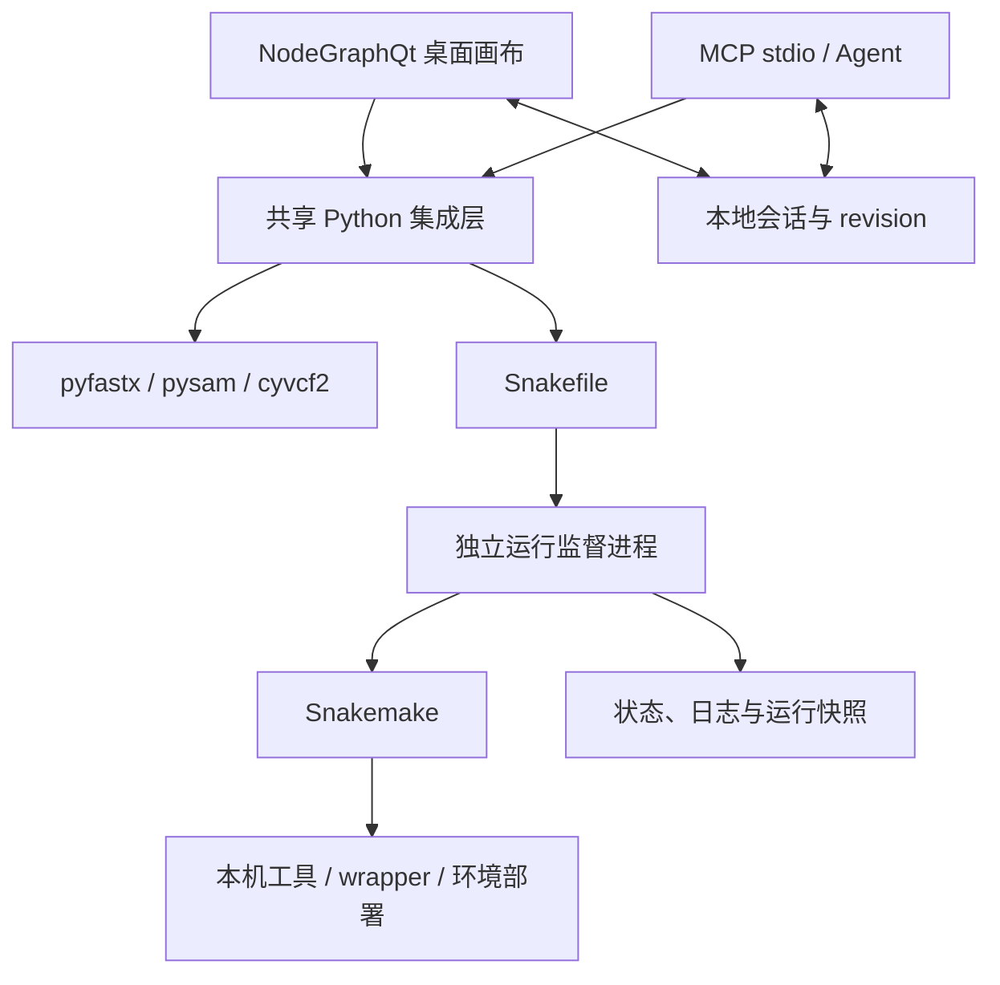

# OpenBioWorkstation

**简体中文** | [English](README.en.md)

**面向本地生物信息学分析的可视化工作流构建与执行平台**

OpenBioWorkstation 是面向 Linux 单机环境的生物信息学工作流软件，集成基于 NodeGraphQt 的图形编辑界面、基于 Snakemake 的工作流执行机制，以及基于模型上下文协议（Model Context Protocol，MCP）的程序化访问接口。系统以共享工作区为基础，将分析流程的图结构、工具定义、执行状态与运行记录关联存储，为交互式流程构建和智能体辅助操作提供统一接口。

本项目采用现有开源组件实现图形交互、任务调度与生物数据解析，项目自身主要承担工具元数据适配、工作流编译和运行状态协调。其目标是支持分析过程的可检查性与可追溯性；跨环境结果复现仍取决于输入数据、工具版本、参数及依赖环境的完整记录。

- **工作流构建**：通过节点与连线表达分析步骤及数据依赖，并检查输入、输出端口的格式兼容性。
- **工作流执行**：将节点图编译为 Snakemake 工作流，支持全流程执行、执行至指定节点、单节点重新执行及缓存跳过。
- **过程检查与记录**：以节点状态显示执行进度，提供文件校验、有限记录预览及运行历史。
- **程序化访问**：通过 MCP 支持智能体构建和执行工作流；图形界面与 MCP 接口访问同一工作区。


[界面展示海报](promo/poster.png) · [A3 PDF](promo/poster.pdf) · [展示材料与声明依据](promo/copy.md)

## 安装与快速开始

需要 Linux、Python 3.11+ 和可用的桌面环境。`uv` 用于下面的安装示例。实际生信工具及 Conda/Mamba 按运行模式另行安装；纯 shell 流程不要求 Conda。

```bash
git clone https://github.com/ArchitektSpeer/openbioworkstation.git
cd openbioworkstation
uv venv .venv
uv pip install --python .venv/bin/python -r requirements.txt
./run-demo.sh
```

离线演示使用合成 FASTQ / FASTA，执行文件检查和 HTML / JSON 报告生成；演示流程本身不需网络或 Conda，但首次安装 Python 依赖需要可用的软件源。它不执行测序质控、比对或变异分析。操作详见 [演示说明](examples/README.md)。

打开普通工作区：

```bash
.venv/bin/python -m ui.workstation_window --workspace ~/biows/projects/demo
```

## 与 Agent 协作开展生物信息学分析

研究者负责研究问题、实验设计、参数选择与结果解释；Agent 通过 MCP 检索工具、构建节点图、发起运行并整理执行证据。这里的“实验”指计算分析，不涉及湿实验设备控制。

- [中文教程：配置、调用示例与真实样本分析](docs/agent-workflow.zh-CN.md)
- [English tutorial: setup, tool calls and real-data analysis](docs/agent-workflow.en.md)
- [中英双语宣传文案与素材](promo/README.md)

建议先完成教程中的合成 FASTQ → SeqKit 统计练习，再迁移到真实数据。教程中的工具调用已按当前 MCP 接口编写；具体 Agent 客户端的兼容性需单独验证。

## 系统架构与实现



图结构检查用于拒绝格式不兼容的连线、重复输入和有向环。文件检查分发给成熟解析库；快速预览只读取有限记录，不能证明全文件完整。图结构保存为 JSON，UI 与 MCP 使用 revision 乐观锁避免静默覆盖。每次运行保留 Snakefile、会话、命令与状态；独立监督进程可在 UI / MCP 退出后继续记录运行。

### MCP 接入

```bash
.venv/bin/python -m mcp_server.bio_mcp --workspace ~/biows/projects/demo
```

客户端配置模板（将 `/path/to` 换成实际绝对路径）：

```json
{
  "mcpServers": {
    "openbioworkstation": {
      "command": "/path/to/openbioworkstation/.venv/bin/python",
      "args": ["-m", "mcp_server.bio_mcp", "--workspace", "/path/to/workspace"],
      "env": {"PYTHONPATH": "/path/to/openbioworkstation"}
    }
  }
}
```

MCP 服务提供 9 个高层工具，覆盖工具检索、节点添加、端口连接、异步执行、状态查询、输出预览、Bioconda 自动封装及按需封装任务管理。自动封装默认未审核，须审核后才能默认执行。已通过 stdio 客户端验证，尚未在 Claude Desktop 等真实客户端中验证。

### 工具与配置

当前提供 5 个内置 wrapper 定义（fastp、BWA index/mem、SAMtools sort/index），以及基础本机工具节点（fastp、BWA index/mem、SAMtools view/sort/index、BCFtools stats、SeqKit stats）；当前代码还定义了 SAMtools 过滤去重和基于 pysam 的病毒位点统计节点。此外可用 `python -m glue.fetch_catalog --all` 下载上游元数据，建立来自 snakemake-wrappers、nf-core/modules 与 Bioconda 的工具索引。现有记录包含 15,447 条索引条目；该数值反映特定元数据快照的规模，不等同于已验证可执行工具的数量（见“当前限制”）。依赖外部工具的本机节点仅在相应包和可执行文件存在时出现；病毒位点统计节点基于 Python/pysam。可用以下命令建立本机环境：

```bash
conda create -y --solver libmamba --override-channels \
  -c conda-forge -c bioconda --strict-channel-priority \
  -p ~/.cache/biows/common-tools fastp bwa samtools bcftools seqkit
```

`BIOWS_COMMON_ENV` 可指定另一套已安装环境。默认配置在 `~/.config/biows/config.yaml`，支持 `--config FILE`：

```yaml
workspace: ~/biows/projects/demo
cores: 4
deploy: conda
conda_bin: /opt/miniconda3/bin/conda
allow_unreviewed: false
llm_base_url: https://api.deepseek.com
llm_api_key: ""
llm_model: deepseek-flash
allowed_input_roots:
  - ~/biows/input
```

输入必须位于工作区或许可根目录内，MCP 输出预览限于工作区。上游目录与环境选项见 [设计文档](DESIGN.md)。

### 基于预定义清单的工具批量封装

`tool_packs/top50.yaml` 收录 50 个常用工具，全部提供 `biows` 定义（其中 11 个为目录输出，用 `directory: true` 标记）。执行：

```bash
python -m glue.wrap_batch --manifest tool_packs/top50.yaml \
  --conda /opt/miniconda3/bin/conda
```

命令会为每个包创建独立 Conda 环境（固定 conda-forge + bioconda，不使用 defaults 渠道）、写入 `auto:` 定义并执行一次可执行程序可用性检查。定义默认 `reviewed=false`，需在画布右键“标记为已审核”后才会被默认运行。多子命令工具（如 `samtools-faidx`）通过 `binary` 字段复用同一环境；个别工具可加 `dependencies`（如 quast 固定 `python=3.11`）。

合成数据冒烟测试（可选）：

```bash
python validation/wrap_smoke.py --review-passed
```

脚本用合成的 FASTA/FASTQ/BED/VCF/GTF/BAM 逐个执行定义中的 shell，检查退出码与输出文件；`--review-passed` 会只把通过的条目标记为已审核。

现有验证记录显示，50 个工具已完成封装，其中 46 个完成合成数据冒烟测试并通过审核，另 4 个（GATK、MACS3、SPAdes、Flye）仅完成可执行程序可用性检查。端到端验证覆盖 `seqkit`（auto）、`fastp`（`smk:` wrapper + Conda）、`fastqc`（目录输出）、`bcftools query`（真实 VCF）与 `samtools flagstat`（真实 BAM）。运行期会自动隔离 conda 默认渠道，避免 conda 26 的 ToS 阻塞。

### 索引工具的按需封装

工具库右键任意 `conda:` / `auto:` 条目 →「按需封装/校验（后台）」，或：

```bash
python -m glue.wrap_service --tool conda:fastp --wait
```

MCP 客户端可调用 `wrap_tool("conda:fastp")`，再用 `get_wrap_job(job_id)` 查询。

流程：建环境 → 抓取 `--help` → LLM 生成定义（需配置 `llm_base_url` / `llm_model` / `llm_api_key`，或使用 `BIOWS_LLM_*` 环境变量）→ 校验 → 合成输入试运行 → 落盘。状态：

- `wrapped`：定义已生成且试运行通过，但仍为未审核；
- `needs_review`：定义已生成但试运行失败，需要人工检查并修订参数；
- `needs_definition`：未配置 LLM 或生成失败，帮助文本已返回。

未配置 LLM 时，系统仍可创建环境并提取帮助文本，供研究人员或智能体补充工具定义。

### 预热常用工具

```bash
python validation/prewarm_tools.py --conda /opt/miniconda3/bin/conda
```

读取 `tool_packs/prewarm.txt`（191 个常用包），对已索引但未封装的包批量执行按需封装；自动跳过已封装/不存在的包，剩余磁盘低于 25GB 时停止，结果写入 `validation/prewarm-result.json`。

## 应用案例：WSMV 共感染分析

该案例使用 12 个 RNA-seq 文库，展示工具连接、工作流执行及结果分析的应用过程。现有案例摘要报告：在对 TriMV 共感染与 WSMV 宿主内多样性之间关系的分析中，73 个受检位点均未达到 FDR < 0.10 的显著性阈值。该结果仅表示在所采用的样本、分析方法及统计阈值下未检出显著关联，不能据此推断不存在效应或不同条件之间具有统计等效性。

此案例用于说明软件在具体分析任务中的应用过程，不构成通用生物学有效性验证；部分分析步骤使用案例专用节点。


公开仓库包含软件、文档、展示图像及经授权发布的[研究展示附件](promo/research/README.md)，包括案例稿件、研究介绍、软件展示流程和另一项小麦叶绿体 RNA 编辑探索性报告。附件为既有成品，不作为已发表或经同行评审的成果宣传。完整原始数据、分析脚本、参考文件与运行工作区未发布，因此本仓库仍不构成完整研究复现归档。历史截图中的案例专用节点不能直接视为默认已验证工具；当前可用节点见上文。

## 当前限制

- 既有验证记录中的索引规模为：下载上游元数据后索引 15,447 条（snakemake-wrappers 418、nf-core 2,125、Bioconda 12,888）。可直接执行的限于 5 个内置 wrapper、当前注册表中满足依赖条件的本机节点，以及本机按需封装的 Bioconda 工具；Top-50 清单 50 个工具已提供定义（46 个通过合成数据冒烟并审核，11 个目录输出）。nf-core 仅 86 个模块可自动生成 shell；其他 Bioconda 条目需按需封装并审核。
- `smk:` wrapper + Conda 链路已用 fastp 实测跑通（首次需联网下载 wrapper 与环境）；上游 418 个 wrapper 未逐个验证。
- MCP 已验证 stdio 接口，尚未在真实 Agent 客户端（如 Claude Desktop）中实测。
- Linux 单机，无多用户、远程协作或集群配置界面；无多样本通配符展开，使用多条节点链。
- nf-core 转换保守，不能静态转换的模块不可运行；CWL 仅支持静态 File/File[] 端口与静态输出名，需另装 cwltool。
- 格式标签不等于生物学语义校验；快速预览不等于全文件验证。没有已验证的性能或速度承诺。
- 按需封装生成的定义默认未审核；合成输入试运行通过不代表真实数据/参数正确，使用前请检查 shell 与端口。

## 开发、验证与展示材料

设计、完成度与验证边界以 [DESIGN.md](DESIGN.md) 为准。测试：

```bash
uv pip install --python .venv/bin/python -r requirements-dev.txt
.venv/bin/python -m pytest -q
.venv/bin/ruff check glue ui mcp_server examples tests
```

展示图由软件离屏渲染截图及案例结果图构成，未使用 AI 生成的软件界面。安装 Pillow 与 Noto Sans CJK SC 后可重建：

```bash
python promo/scripts/make_grid.py
python promo/scripts/make_poster.py
```

素材来源、裁切与声明依据见 [物料说明](promo/README.md)，视觉复核见 [review_log.md](promo/review_log.md)。

## 许可证

[MIT](LICENSE)，版权人 OpenBioWorkstation contributors。依赖组件和实际调用工具遵循各自的许可证。
