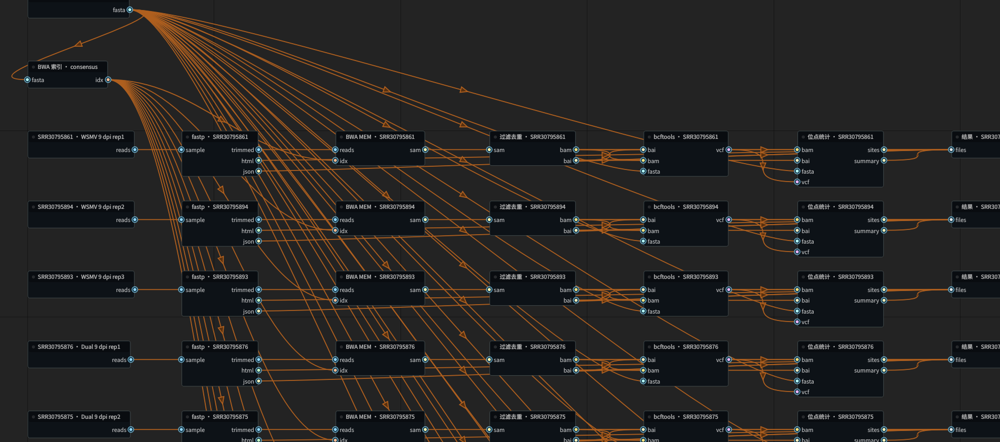

# OpenBioWorkstation

[English](README.md) | **简体中文**

**面向研究者与 Agent 协作的生物信息学可视化工作站**

OpenBioWorkstation 是用于构建、执行和检查生物信息学工作流的 Linux 桌面软件。系统结合节点图编辑、Snakemake 执行和模型上下文协议（MCP）接口，使研究者与 Agent 能够操作同一本地工作流，并查看分析步骤、执行日志和输出文件。

研究者确定科学问题、选择分析方法并审查结果；Agent 可协助检索工具、构建流程、执行任务和检查输出。这种分工使 Agent 能够参与计算分析，同时保留研究者对方法选择及生物学解释的审查职责。



*WSMV 应用案例的工作流局部，包含案例专用节点。*

## 主要功能

- 连接输入、工具和输出节点构建工作流，并检查端口的文件格式兼容性。
- 执行完整流程、运行至指定节点或重新执行单个步骤，在适用时复用已有结果。
- 检查输入和输出文件，查看节点执行状态及历史运行记录。
- 通过 MCP 让 Agent 与桌面界面操作同一工作区。
- 使用 LLM 根据命令行帮助生成工具定义，再进行检查、试运行与审核。

## 安装

需要 Linux、Python 3.11 或更高版本，以及图形桌面环境。以下示例使用 `uv`。实际分析所需的生物信息学软件需另行安装。

```bash
git clone https://github.com/ArchitektSpeer/openbioworkstation.git
cd openbioworkstation
uv venv .venv
uv pip install --python .venv/bin/python -r requirements.txt
./run-demo.sh
```

演示检查合成 FASTQ 和 FASTA 文件，并生成 HTML 和 JSON 报告。安装 Python 依赖后，演示可在无网络、无 Conda 的环境中运行。它展示文件检查与流程执行，不进行读段过滤、比对或变异分析。具体操作见[演示指南](examples/README.md)。

## 使用桌面工作站

为自己的分析打开独立工作区：

```bash
.venv/bin/python -m ui.workstation_window --workspace ~/biows/projects/my-analysis
```

1. 添加输入节点，选择数据文件，在构建流程前查看文件预览。
2. 在工具库中检索并添加所需节点，连接格式兼容的输入和输出端口。
3. 检查工具参数，并在正式执行前进行预演（dry-run）。
4. 执行流程，查看节点状态与日志。后续修改可运行至指定节点，或在上游结果已存在时单步重新执行。
5. 检查输出文件并保存工作区。结果保存在 `results/`，运行记录保存在 `runs/`。

当前界面采用中文菜单。使用“全量运行”执行完整流程，使用“预览输出文件”检查结果，按 **Ctrl+S** 保存会话。演示工作区应通过 `./run-demo.sh` 打开，以加载演示专用工具。

## 工具使用与检索

工具是否可用取决于已安装的可执行程序、下载的元数据和本机工具定义。软件提供 5 个内置 wrapper 定义，涵盖 fastp、BWA index/mem 和 SAMtools sort/index。本机节点还支持 SAM/BAM 转换、过滤去重、变异统计和序列统计等操作。

可使用 Conda 安装常用工具：

```bash
conda create -y --solver libmamba --override-channels \
  -c conda-forge -c bioconda --strict-channel-priority \
  -p ~/.cache/biows/common-tools fastp bwa samtools bcftools seqkit
```

若这些软件安装在另一 Conda 环境中，可通过 `BIOWS_COMMON_ENV` 指定环境路径。依赖外部程序的本机节点要求环境中同时具备软件包元数据和对应的可执行文件。

仓库另提供[工具清单](tool_packs/top50.yaml)，包含涉及 42 个软件包的 50 条节点定义。克隆仓库不会自动安装这些定义所需的依赖。

**2026 年 11 月 1 日的本机安装快照**包含 69 个软件包的 78 个封装节点；连同 5 个内置定义和 10 个本机节点，共有 93 个节点定义，其中 62 个带审核标记。目录包含 15,524 条可检索索引。这些数字描述该次本机安装，不代表新安装的默认配置。软件包、节点定义和索引条目采用不同统计口径，工具审核范围正在逐步扩大。

如需检索更广泛的工具，可下载上游目录元数据：

```bash
.venv/bin/python -m glue.fetch_catalog --all
```

目录收录 Snakemake Wrappers、nf-core 和 Bioconda 等来源的工具信息。可检索不表示工具可直接执行，也不表示其已针对具体分析完成验证。

## 与 Agent 协作分析

将支持 MCP 的 Agent 客户端连接到桌面界面使用的同一工作区。以下为通用 stdio 配置示例；请将路径替换为实际绝对路径，并按客户端要求设置配置。

```json
{
  "mcpServers": {
    "openbioworkstation": {
      "command": "/absolute/path/openbioworkstation/.venv/bin/python",
      "args": ["-m", "mcp_server.bio_mcp", "--workspace", "/absolute/path/biows/projects/my-analysis"],
      "env": {"PYTHONPATH": "/absolute/path/openbioworkstation"}
    }
  }
}
```

MCP 接口支持工具检索、读取流程和工具配置、增删改节点、连接与断开端口、异步执行与取消、历史查询、文件检查及工具适配任务。Agent 修改工作区前应先保存桌面修改；收到外部修改提示后，重新加载并核对会话。

可以从以下任务描述开始：

> 检查输入文件，确认所需工具并构建工作流。正式执行前先进行预演。报告实际运行 ID、输出路径及错误，并区分已执行的操作与尚未执行的分析步骤。

[双向编辑与运行快照](docs/agent-editing.zh-CN.md)说明修订冲突、未审核工具执行选项及历史结果检查。

[Agent 协作教程](docs/agent-workflow.zh-CN.md)提供完整的合成 FASTQ → SeqKit 统计练习、工具调用示例及真实数据分析说明。MCP stdio 接口已有执行验证；[Qoder CN 真实推理](docs/qoder-mcp-validation.zh-CN.md)已完成合成 SeqKit 分析闭环，其他 Agent 客户端仍需分别检查。

## LLM 辅助工具适配

对于缺少合适节点定义的索引工具，可在工具库右键选择“按需封装/校验（后台）”，或执行：

```bash
.venv/bin/python -m glue.wrap_service --tool conda:fastp --wait
```

软件创建依赖环境并提取命令行帮助后，可调用 LLM 生成输入、输出、参数和执行命令的定义，再进行结构检查与合成输入试运行。使用前需配置 `llm_base_url`、`llm_model` 和 `llm_api_key`，或对应环境变量 `BIOWS_LLM_BASE_URL`、`BIOWS_LLM_MODEL` 和 `BIOWS_LLM_API_KEY`。模型端点需支持本软件使用的 chat-completions 请求格式。

生成定义默认为未审核。应检查命令、端口、参数和试运行结果，再标记审核状态。合成数据试运行成功不表示定义适用于真实样本。未配置 LLM 时，仍可创建环境并提取帮助文本，但工具定义需要另行提供。

## 配置与数据访问

默认配置文件为 `~/.config/biows/config.yaml`。最小配置示例：

```yaml
workspace: ~/biows/projects/my-analysis
cores: 4
deploy: conda
conda_bin: conda
allow_unreviewed: false
allowed_input_roots:
  - ~/biows/input
```

桌面应用和 MCP 服务支持通过 `--config FILE` 指定其他配置。输入文件必须位于工作区或许可输入目录中；MCP 文件检查限于工作区内的文件。

分析执行与文件存储在本地完成。下载依赖和调用模型可能需要网络；外部 Agent 是否发送提示词及工具返回内容，取决于客户端设置。应根据所分析数据的要求选择相应设置。

## 应用示例

[研究案例材料](promo/research/README.md)包括 WSMV/TriMV 共感染分析、软件操作展示及小麦叶绿体 RNA 编辑探索性报告。

WSMV 案例使用 12 个 RNA-seq 文库。在所报告的共感染与 WSMV 宿主内多样性分析中，73 个受检位点均未达到 FDR < 0.10。该结果不证明不存在效应或统计等效。案例包含专用分析步骤，相关报告不作为经过同行评审的论文介绍；完整原始数据和分析工作区未随仓库提供。

## 适用范围与限制

当前版本面向 Linux 单机分析，不提供多用户服务、远程协作或集群配置界面。多样本通过独立节点链表示，尚不支持样本通配符展开。

文件格式检查用于判断数据类型兼容性，快速预览仅检查有限记录；两者均不能替代完整文件验证或生物学适用性判断。上游适配器仅支持索引生态中的部分工具，使用前应检查定义、依赖和参数是否符合分析需求。

## 许可证

OpenBioWorkstation 采用 [GNU GPL v3.0 许可证](LICENSE)。许可证标识为 `GPL-3.0-only`。依赖组件与实际调用的生物信息学工具遵循各自的许可证。

## 多模型开发工厂

[本地软件工厂](docs/software-factory.zh-CN.md)已实现实际 CLI 路由、独立 worktree、SQLite 状态、限次修复、质量检查、独立复审和草稿 PR。[真实执行记录](docs/software-factory-validation.zh-CN.md)区分已调用模型与仅核验目录的适配器。
