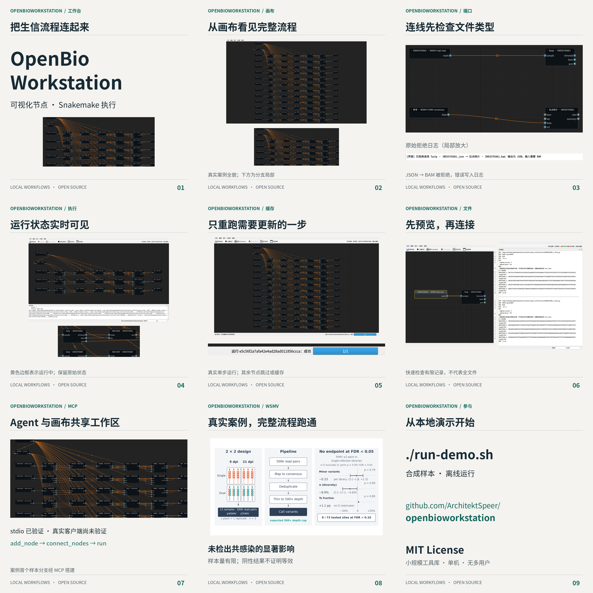

# OpenBioWorkstation 宣传文案

## 一句话定位

把生信流程连起来，让每一步可见。

## 一段话简介

OpenBioWorkstation 是面向 Linux 的本地生信节点工作台。用画布连接输入、工具与输出，编译为 Snakemake 执行，支持单步重跑、缓存跳过、状态着色和文件预览。Agent 可通过 MCP 操作同一工作区。WSMV 案例已跑通完整流程；当前工具生态尚小，面向单机使用。

## 社交媒体

### 小红书

🧬 生信流程，也可以连起来看！OpenBioWorkstation 把节点画布、Snakemake 和 MCP 接在一起：连线检查文件类型，运行时看节点状态，需要更新时单步重跑，还能预览文件。💻 全部在本地执行。WSMV 真实案例跑通完整流程，结果是未检出共感染的显著影响，不能当成重大生物学发现。项目还早：工具库小、单机、无多用户；MCP 已做 stdio 验证，真实客户端尚未验证。MIT 开源，先试试离线演示吧！#生物信息学 #开源工具 #Snakemake

### 微博

OpenBioWorkstation：用节点画布组织本地生信流程，交给 Snakemake 执行。类型检查、单步重跑、缓存跳过、状态着色、文件预览与 MCP 接入。WSMV 案例完整跑通；工具生态尚小，单机使用。MIT 开源，附离线演示。

### 技术社区（英文）

OpenBioWorkstation is a Linux desktop workflow editor built with NodeGraphQt, Snakemake, and the MCP SDK. A shared Python layer checks port formats, compiles the canvas into a Snakefile, and records run snapshots. The UI supports partial runs, forced single-step reruns, cached skips, and file previews. MCP edits share the same workspace with revision checks. A WSMV case exercised the full workflow; it yielded a limited negative result. There are five built-in wrapper definitions and eight local tool nodes, conditional on installed binaries. Upstream catalog scale, real MCP clients, and the smk: wrapper-plus-Conda path remain unverified. This is a single-machine project with no multi-user mode. MIT licensed; a synthetic offline demo is included.

## README Hero

把生信流程连起来，让每一步可见。

Linux 本地生信节点工作台，由成熟开源组件与 Python 胶水层组成。

- 节点画布与文件格式端口检查。
- 编译为 Snakemake，支持全量、运行至此、单步重跑与缓存跳过。
- 节点状态实时着色、文件校验与预览、运行历史。
- MCP 让 Agent 搭图与运行，UI 与 Agent 同步共享工作区。

## 功能对比

以下为工作方式比较，不把其他图形化工具视为同一种实现。

| 维度 | OpenBioWorkstation 当前实现 | 手写 Snakemake 脚本 | 图形化流程工具 |
|---|---|---|---|
| 流程表达 | 桌面节点画布，编译为 Snakefile | 直接编写规则，表达能力取决于脚本 | 依具体产品而异，通常用画布或表单 |
| 类型检查 | 连线时检查格式标签，不证明语义正确 | 可由作者加入检查 | 依产品及工具定义而异 |
| 调度与缓存 | 委托 Snakemake | 使用 Snakemake | 依产品后端而异 |
| Agent 接入 | MCP stdio 已验证，真实客户端尚未验证 | 需自行集成 | 依产品而异 |
| 工具生态 | 5 个内置定义 + 8 个条件可用的本机节点 | 可自行封装命令或使用上游 wrapper | 依产品及部署配置而异 |
| 多样本 | 多条节点链，无通配符展开 | 可直接编写通配符规则 | 依产品而异 |
| 部署与协作 | Linux 单机，无多用户、无集群配置界面 | 可自行配置执行环境 | 部分产品提供服务端协作；不能一概而论 |

## 常见问题

1. **和 Galaxy / nf-core 有什么不同？** 本项目定位是本地桌面胶水层：用 NodeGraphQt 画图，再交给 Snakemake。没有 Galaxy 式多用户服务；nf-core 元数据适配代码已存在，但上游库尚未下载，不能宣称已支持整个生态。这里不替代完整的平台或经验证的领域流程。
2. **需要会写代码吗？** 预置离线演示可直接操作画布；使用现有节点仍需理解文件格式、工具参数和环境安装。新增复杂工具可能需要编写、审核封装，不能承诺零代码完成所有分析。
3. **数据会上传吗？** 分析与工作区均在本地，本软件没有数据上传服务。安装依赖、下载输入或获取 wrapper/Conda 环境可能访问网络，需自行管理所选工具和 Agent 客户端的数据策略。
4. **能直接运行海报里的 WSMV 流程吗？** 图中包含案例自定义节点。公开仓库只有软件、文档和宣传成品，不含该案例的原始数据、分析脚本、报告或论文；先用 `./run-demo.sh` 体验合成文件检查流程。
5. **现在有哪些验证边界？** MCP 已用 stdio 客户端验证，尚未在 Claude Desktop 等真实客户端实测；`smk:` wrapper + Conda 尚未真实跑通。当前仅 5 个内置 wrapper 定义与 8 个本机工具节点，上游规模未实测；无多用户与多样本通配符展开。

## 依据索引

| 能力声明 | 依据 |
|---|---|
| Linux 节点画布、格式检查 | DESIGN.md §1 G1、§5.4、§7 |
| Snakemake 编译、三种运行、缓存、状态、历史 | DESIGN.md §1 G2–G3、§5.3–5.4 |
| 文件校验、有限预览 | DESIGN.md §1 G4、§5.1 |
| MCP 搭图与运行、同步和 revision 检查 | DESIGN.md §1 G6、§5.5、§9 |
| 5 个内置定义、8 个本机节点及安装条件 | DESIGN.md §1 G5、§5.2.1–5.2.3 |
| 上游规模、真实客户端和 smk: + Conda 未验证 | DESIGN.md §1、§13–15 |
| 本地架构、无多用户和通配符 | DESIGN.md §1.2、§3、§8–10 |
| 离线演示为合成检查流程 | examples/README.md |
| WSMV 完整流程与受限阴性结论 | 本地 LOGBOOK：B3、B4、D 结束审核；论文 Summary（未随仓库发布） |

案例证据公开范围限于 `assets/` 内成品图片。案例自定义节点不是内置软件能力。所有数字均为当前实现计数或案例既有结果，无新增性能测试或速度承诺。
